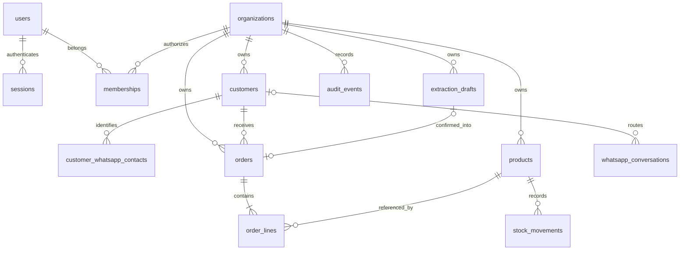

# Database schema and invariants

Migration: `services/api/alembic/versions/0001_initial.py` (explicit immutable schema,
not an import of live models). Migrate with `alembic upgrade head`; compare with
`alembic check`. Back up before production migration. Downgrade destroys Phase 1 tables
and is only for disposable environments, not an operational rollback plan.

| Table | Important fields and constraints |
|---|---|
| users | UUID ID; unique normalized email; name; Argon2 hash |
| sessions | SHA-256 token hash PK; user FK; expiry timestamp |
| organizations | name, plan, subscription state, monthly order allowance |
| memberships | composite user/organization PK; owner/admin/staff/viewer CHECK |
| customers | tenant FK, name, phone, address, active; unique `(organization_id,id)` |
| customer_whatsapp_contacts | tenant FK, customer composite FK, normalized international WhatsApp number; tenant-unique phone identity |
| products | tenant FK, SKU, aliases JSON, unit, integer price/stock/reorder; tenant-unique SKU; nonnegative checks |
| extraction_drafts | tenant FK, original message, validated result JSON, actor, creation time |
| orders | tenant FK; composite customer/draft FKs; snapshots; state; total; request hash; tenant-unique idempotency key and draft ID |
| order_lines | tenant FK; composite product/order FKs; name and unit-price snapshots; positive integer quantity |
| stock_movements | tenant FK; composite product FK; signed quantity, reason, actor, time |
| audit_events | tenant FK; action, entity ID, actor, time; no raw customer messages |

All money is integer **LKR cents**; `25000` means LKR 250.00. The order service
computes totals and compares them to the user's reviewed `expected_total_minor`.
Quantities are whole catalog units; conversion/fractional units are outside Phase 1.

Every business table has an organization index and a tenant filter in API queries.
PostgreSQL applies FORCE RLS with `app.organization_id`, set transaction-locally after
membership authorization. No tenant context means no visible business rows. Context
does not survive connection-pool reuse. Runtime connections must not bypass RLS.

The backend alone accesses users/sessions/memberships/organizations. These tables
are not browser-accessible. Migration revokes PUBLIC, `anon` and `authenticated`
table privileges when those roles exist. A custom server-only runtime role receives
explicit privileges. Never use a Supabase service key or DB credential in the frontend.

The organization row lock serializes catalog mutations, stock adjustments, monthly
quota checks, order confirmation and cancellation. This is intentionally simple for
Phase 1. Product locks and stock checks run before writes; the order, lines, stock
ledger and audit event are one transaction. PostgreSQL concurrency tests exercise
two simultaneous orders against insufficient shared stock.

Cancellation is idempotent; stock is restored once. Fulfilled and cancelled orders
cannot transition further. Cancelled orders still consume the monthly allowance;
this prevents unlimited create/cancel cycles. Month boundaries use Asia/Colombo.

### Role matrix

| Operation | Owner/admin | Staff | Viewer |
|---|---|---|---|
| Read catalog/orders/analytics/invoices | Yes | Yes | Yes |
| Create/edit/archive customer or product | Yes | No | No |
| Adjust stock | Yes | No | No |
| Extract/review/confirm order | Yes | Yes | No |
| Fulfill/cancel order | Yes | Yes | No |
| Audit feed | Yes | No | No |

Phase 1 has no membership management endpoint. Provision additional memberships via
an authenticated administrative process after verifying the user's identity; invitations
and role-management UI are intentionally deferred.
